:::tip[Preface]
`GMT+8` This [event](https://prince213.top/events/nixos-cn-meetup-1/) took place
on August **9th, 10th** in [Shanghai, China](https://en.wikipedia.org/wiki/Shanghai),
, hosted by [@prince213](https://prince213.top), was the **first** conference in China
dedicated to `Nix`. Funding support provided by the [NixOS Foundation](https://nixos.org/community/).
For live stream records,
You can find [**@NixChina**](https://www.youtube.com/@NixChina) on the [YouTube](https://www.youtube.com).
Links: [**NixCN Conference #1**](https://youtu.be/TiTPDILfRbM?si=NdP-ambsyRRMnXF2)
/
[**NixCN Conference #2**](https://youtu.be/prqA1qlWcTQ?si=mWTRdgJwVG1bu3th).
:::

---


A note before we start: this piece was written in August 2025, days
after I came home from China's first Nix conference. I was a NixOS user
then, with a workstation, a flake, and a package PR to my name. As of
this year, I've moved on to [F44](#fedora). I'm leaving the article up anyway,
lightly annotated, as a memento of the summer when I was all in.

What follows is the record of those two days, plus what I still think
of Nix. It is also, I should warn you, the story of a socially anxious
high schooler who spoke fewer than ten sentences in forty-eight hours.

As someone with severe social anxiety, I've always preferred
expressing myself online. I dare not say a single word to people I'm
not close to, and most of the time I didn't even know what I was
afraid of. Watching everyone chat freely made me want to join in too.
I just couldn't bring myself to speak. _It is, too, really, too hard_.

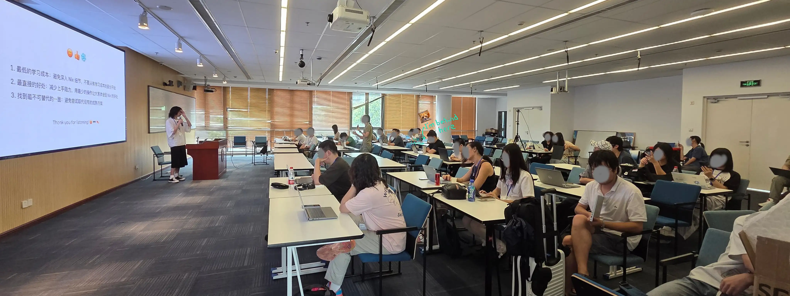

## First Met

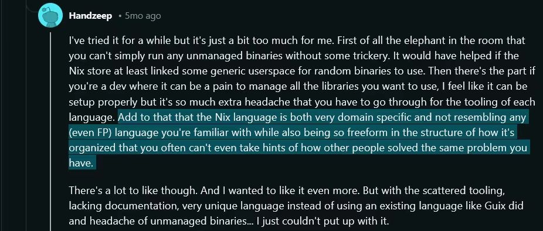

I found this screenshot from June 2024 in my photo album.
I probably first learned about Nix around then, though
it wasn't until February 2025 that I actually started using NixOS.
_In early August_, I saw the promotion for
[the Conference](https://nixos.party/) and joined their
[channel](https://t.me/nixcnmeetup), but I froze the moment I saw the
sign-up form. It's, uh, _scary_.

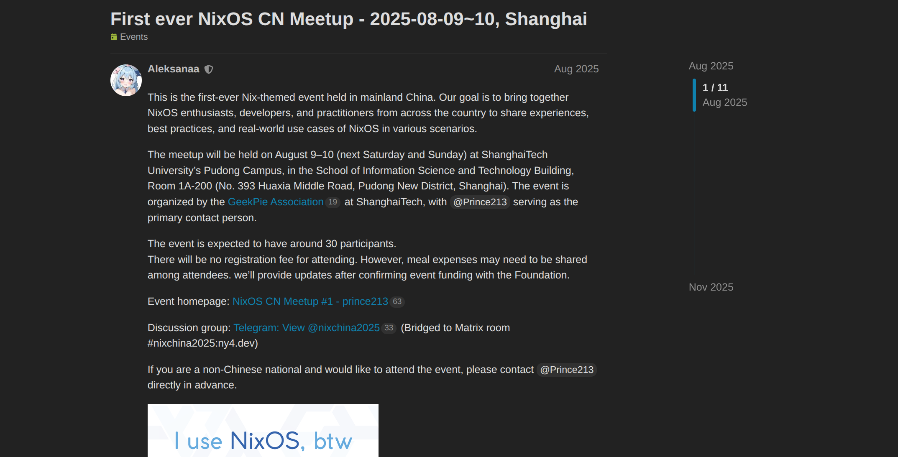

Should I go _or not_? I couldn't figure out why I hesitated.

- If I don't speak up now, eventually, _I'll have to._
- If I can't learn to interact now, **every interaction
  will fail the same way** in the future.
- Or, was it because I lacked confidence in my _looks_?

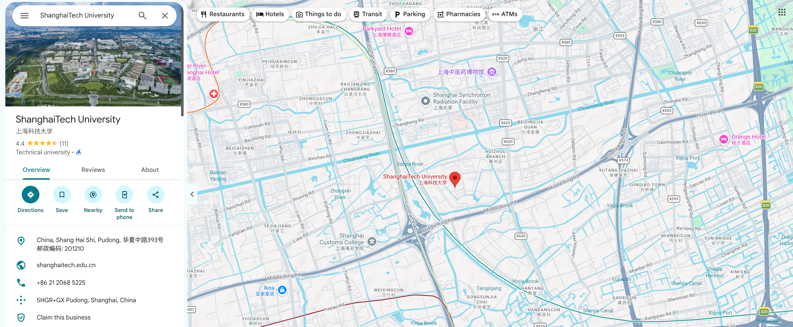

Well, I don't care about my appearance. Nobody gets to decide it
anyway. _Just keep it tidy_, and that's that. I have to show my face to
people sooner or later; can anyone hide forever? High school doesn't
leave me much time to gain social experience. So, after hesitating for
a long time, I decided: _just go for it_. After all, I'm still a
student - it's okay to embarrass myself a little. **I might as well get
all the awkward moments of my future out of the way in advance**, and,
:spoiler[**it even counts as a gain(?)**].

Eventually I decided. _This was once revealed to me in a dream **:)**_


I told my parents about it, and to my surprise, they agreed
**right away**, and were unusually excited about it. Maybe it's because
I'm not like other high school students who stay home all day? I'm not
sure. Few of us play games or scroll through short videos at home; we're
just a group of students who balance study and activities. In recent
years, the local government leveled several hills and built
[Lishui Airport](https://parametric-architecture.com/mad-lishui-airport-china/)

- even our mountainous corner of the province has flights now. It was
  the perfect chance to take a plane for the first time.

:::tip[I don't know what to say about it, but:]
Some people might laugh at what I'm about to put in this box. I'd
understand, but **I'm not going to lie**, and I'm not afraid of being
laughed at. These are all things I had never done before - that was the
whole point. Looking back now, this trip handed me a pile of **firsts**:

- Flying, on an `Airbus A320`[^1], flight `MU6986`;
- Leaving [Zhejiang Province](https://en.wikipedia.org/wiki/Zhejiang)[^2]
  (think of it as China's **California**, sort of);
- Riding a high-speed train, and then a subway;
- Attending a tech conference entirely on my own;
- And many, many more **...**
  :::

[^1]:
    You know, as an aerospace enthusiast and
    [DCS](https://www.digitalcombatsimulator.com/en/) player, I only
    took my first flight that day.

[^2]:
    Strictly speaking, when we
    [visit relatives](https://www.chineselearning.com/chinese-culture/why-do-people-visit-relatives-during-chinese-new-year),
    geographical factors mean we technically cross the provincial
    border, just barely. But we've _never_ done it with a plan.

When I arrived in Shanghai, I was struck by how **huge** and **crowded**
the city was. The crowds weren't a problem, but the prices, though, were
shockingly high.

---

## Off We Go!

### Take the Plane


Too bad it was a night flight. For a first-time flyer, the view was -
well, there was no view. There was no gamma can be set
like what could we do in many games. After landing,
actually, yes, I used a _COMPASS_ to figure out which subway line to take
Just about passable, for the record. Also perfect blackmail material, I'm sure.

### Reach the Venue

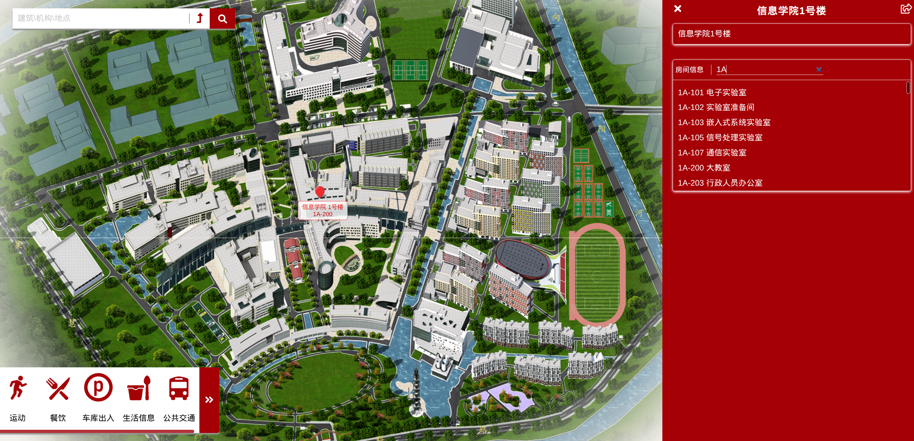

We had access to STU, but it was time restricted. Since I arrived
a few minutes early, I actually couldn't get in on time. Luckily,
@Prince213 guided me in, I _snuck into_ the campus through a small door in
the parking lot, lol.


Once inside, I saw large posters on the
walls, so it was easy to find the venue.

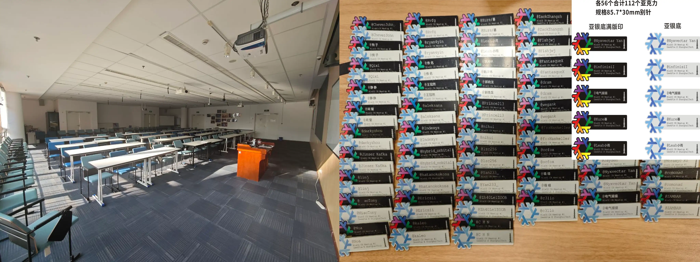

The volunteers had been there since early morning, setting up. Since
this was the first conference of its kind for `Nix` in China,
attendance was, objectively speaking, modest, around sixty people,
judging by the name tags. It was still more than enough to scare me
half to death. Well, I was here now; I might as well get something out
of it, and I'd better _not complain_ again.

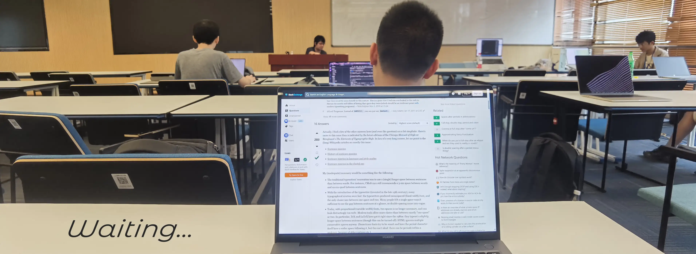

Some of the machines on display were quite special. For instance, there
was a [_**Loongson**_](https://www.loongson.cn/product/show?id=26)[^3]
`3A6000` running `NixOS`, even **playing Minecraft**, which I
hadn't expected at all. And yes, in the middle of **this Linux
conference**, I had brought a _Windows_[^lt] laptop. Uh... maybe if I just
kept SSHing into my workstation over `Tailscale`, nobody would notice.
_Mm... I hope. (Well, very soon I was unmasked. Someone
just said "There's an undercover agent among us!" But to my surprise
that more than three Windows laptops were found out. lol)_

[^3]:
    [_**Loongson**_](https://en.wikipedia.org/wiki/Loongson) is one of
    China's leading brands of homegrown general-purpose CPUs. It
    developed its own independent instruction set architecture,
    `LoongArch`, and its processors power PCs, servers, and embedded
    systems. Details [here](https://www.loongson.cn/EN).

[^lt]: I don't have my own laptop. So I borrowed my dad's :)

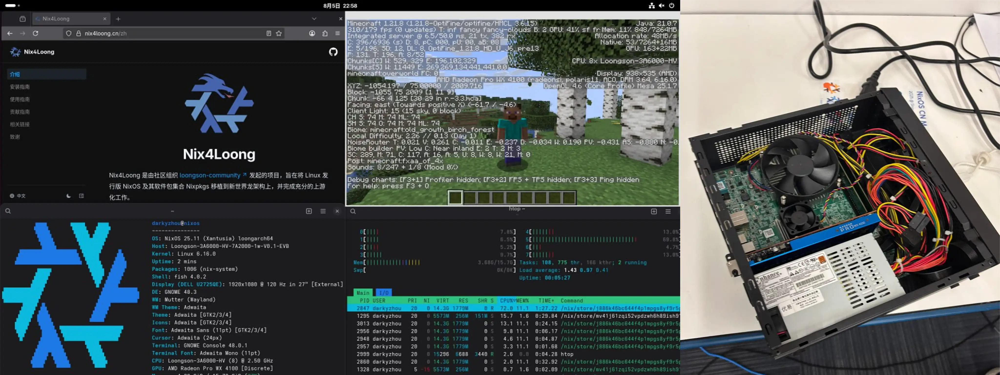

:::tip[About NixOS Compatibility & Stability]
If a homegrown `Loongson` can run `NixOS` smoothly, compatibility
clearly isn't the problem. Stability, on my end, was: my `NixOS` box -
an `R9 9950X` with `DDR5-7200` (`ECC on`) - kept throwing a steady
stream of `Corrected Error` reports from the `L1` cache. I tried many
things to fix it; nothing worked.
I couldn't pin it on the hardware either, because, here's the
funny part - the instability only ever showed up on `NixOS`.
**Perfectly reproducible, bro.**
2026: this machine has since been rebuilt on Fedora.
Now it works fine.
:::

---

## Nix

Two days of talks, a demo table full of unusual hardware, and a lot of
thinking on the flight home. The full agenda lives
[here](https://nixos.party/) ; what follows is what stuck, plus my
thoughts on [Nix](https://nixos.org/) ,
[Nixpkgs](https://github.com/NixOS/nixpkgs) and the
[community](https://nixos.org/community.html) as of August 2025.
Personal, opinionated, and, per the note at the top, written while I
was still a nix user.

:::note[What's Nix?]
A functional package management ecosystem built for reproducible,
rollback-ready environments. "Reproducible" here is mechanical, not
vibes: every package lives in `/nix/store/<hash>-<name>`[^nix-store], and that hash
covers **every input** - source, patches, compiler, build flags. Same
inputs, same store path, on any machine.

| Component | What it actually is                                                                                                                          |
| --------- | -------------------------------------------------------------------------------------------------------------------------------------------- |
| `Nix`     | _The functional language and package manager underneath everything. Builds run in isolation; outputs are content-addressed by their inputs._ |
| `Nixpkgs` | _The package collection built with Nix - packages and NixOS modules in one monorepo, often described as the largest of its kind._            |
| `NixOS`   | _A Linux distro where the whole system - packages, services, users, boot - is declared in Nix and built as one atomic generation._           |

:::

### Routines and Arrangements

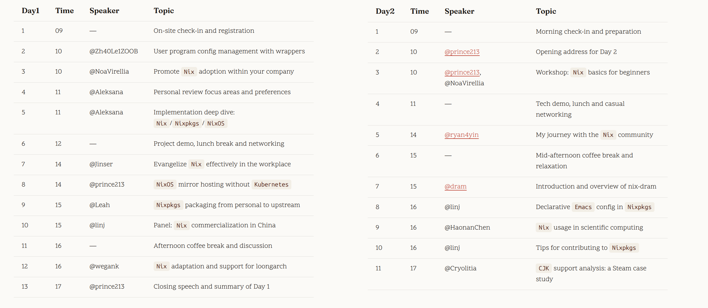

### Time for ~~a Meeting?~~ Class

After that, I did what I do best: I listened. The talks themselves are
all in the [official agenda](https://nixos.party/); what follows is my
own take on [Nix](https://nixos.org/),
[Nixpkgs](https://github.com/NixOS/nixpkgs) and the
[community](https://nixos.org/community.html). Personal, as of
August 2025, when I was still a daily NixOS user.

> If _Gentoo Linux_ grew up alongside me, then K.I.S.S. will crash and burn with me, too.

That is not a metaphor. K.I.S.S. is a great way to build a system and a
terrible way to insure one. On Gentoo, `/etc` is years of handwriting,
`world` is archaeology, and `package.use` is a decision log no one can
reconstruct from memory. And when such a machine dies - by die I mean
_die_, won't-boot, fsck-forever - the recovery procedure is a stage
tarball, a chroot, and whatever you can still recall. There is no
"previous generation" to select. For the philosophy, remember this:

> What kept the system simple is exactly what leaves you with nothing to roll back to.

In the final moments, it looks like this:

```bash
$ rm -rf / # LET'S GO. NO LOOKING BACK.
```

And I really did run that command, on February 2nd, 2025:

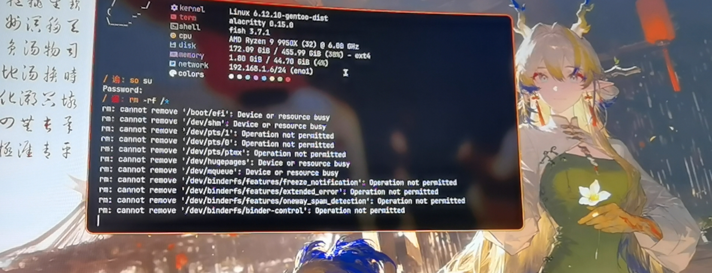

Which is why, sitting in the audience, I kept thinking: Nix is the
system you would design _specifically for Gentoo users_ - for people
who already configure everything by hand, and have already watched it
blow up. Every "obvious" Nix feature is an answer to a wound a tinkerer
already has. How fitting.

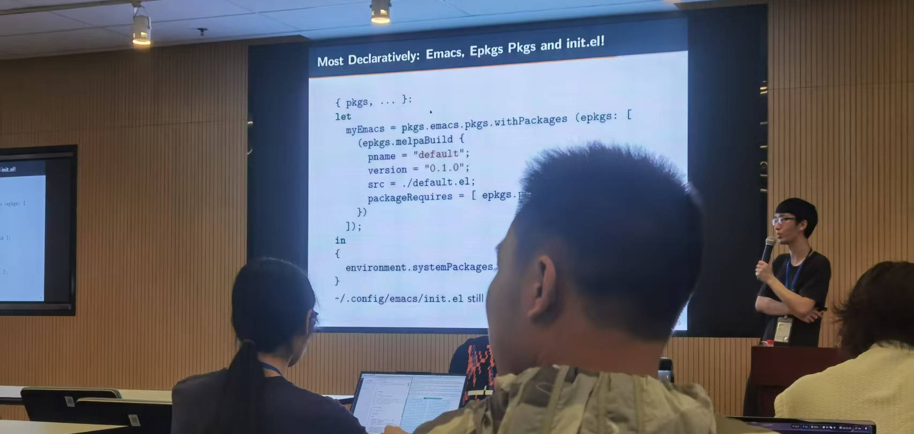

The core trick: _**each** Nix declaration file corresponds to **one**
system environment._ `flake.lock` pins every input to an exact commit;
the store addresses every build output by the hash of all its inputs;
`nixos-rebuild`[^nixos-manual] records each result as a numbered generation. Nothing
is ever patched in place. System crashed? Pick the previous entry in
the boot menu. It is still
there, byte for byte. Broke the config? `nixos-rebuild switch
--rollback`. New computer? One command:

[^nix-store]:
    NixOS Foundation. _Nix Package Manager Guide_ - "Store Paths".
    [Online]. Available: https://nixos.org/manual/nix/stable/store/store-path
    (accessed 2025-08).

[^nixos-manual]:
    NixOS Foundation. _NixOS Manual_ - "Changing the
    Configuration". [Online]. Available:
    https://nixos.org/manual/nixos/stable/#sec-changing-config
    (accessed 2025-08).

```shell title="Build && Rollback"
doas nixos-rebuild switch --flake /path/to/your/flake#your-hostname
```

Just experimenting? `nixos-rebuild test` builds and activates the new
generation **without** adding a boot entry: try things, then decide.
And because one flake describes every machine you own, deployment is
one flag away:

```bash title="Apply Different Declarations"
nixos-rebuild switch --flake .#host --target-host root@host
```

Pushes that machine's configuration over SSH. Syncing
environments across computers stops being a workflow you maintain. It
falls out of the design. For someone with more than one machine, like
myself, that alone is the godsend.

Underneath it all is a fact longtime Unix users feel in their bones: a
traditional system is three separate kingdoms. The **package manager**
rules packages (e.g. `apt`, `dnf`, `pacman`), a pile of dotfiles rules the
**system**, and every **language** ships its own version manager for
its own runtime. Three sources of truth, three ways to drift apart. Nix
collapses all three into a single language: packages, services, and dev
shells are all Nix expressions, evaluated together into one generation.

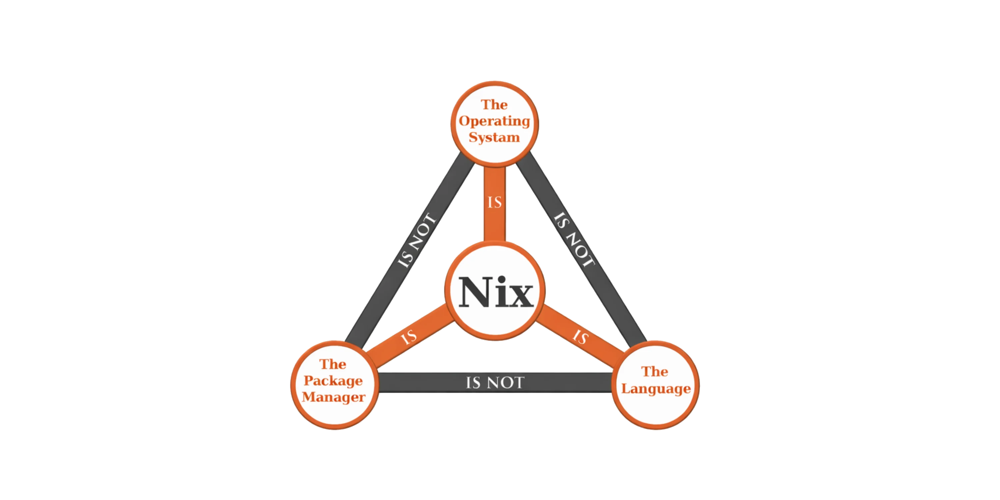

That combination makes `Nix` a great fit for scientific computing.
[Haonan Chen](https://chn.moe) is one of the attendees who has
dabbled in this field. I find him to be a genuinely fascinating
character. What's more, it also suits tinkerers,
especially for people into ricing who are still
distro hopping. No offense intended. I used to be one of them.

That said, it doesn't suit me all that well. First, there's the
**stability issue** I mentioned earlier. Second, `Nix` overshoots my
actual needs: what I do, a workstation plus a handful of containerized
services, is fully covered by `Kubernetes` and `Podman`. Run the code
on the server side, done.

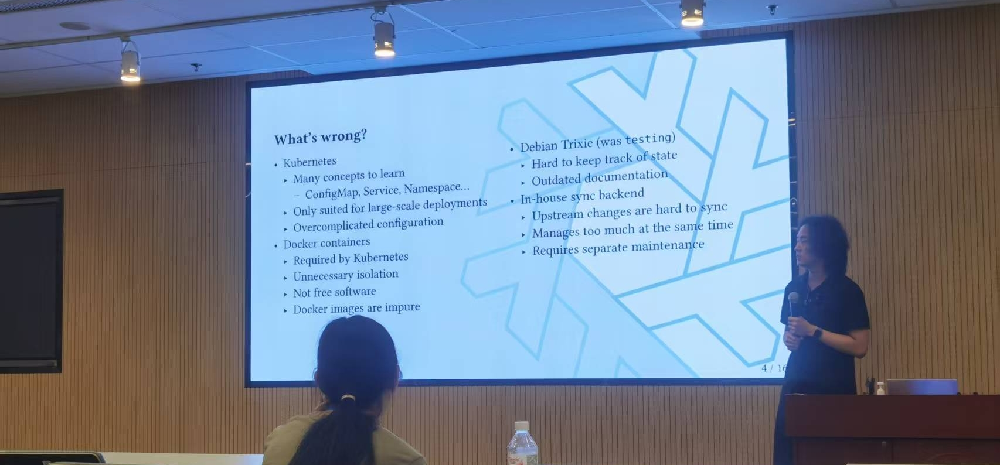

Sure, `Nix` has plenty of advantages over
`Kubernetes` at other layers, and plenty of people legitimately prefer
it, starting with the organizer,
[**@prince213**](https://prince213.top) , whose talk was about
running NixOS mirrors without Kubernetes. Same question, opposite answers.
And then there are the special cases, like
[**@ryan4yin**](https://thiscute.world/en/), author of
[**_The Nix & Flakes Book_**](https://nixos-and-flakes.thiscute.world/).
If you're getting started, that book is the unofficial,
beginner-friendly introduction I'd hand you first. That's the tool.
The community around it is another story.

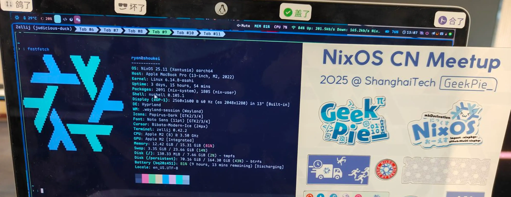


### The Community

The community behind a tool says as much about it as the tool itself.
`Nix` has no corporate owner; its contributors come from all over the
world, and they review each other through
[PRs on GitHub](https://github.com/NixOS/nixpkgs/pulls). That has real
consequences, both good and bad.

Start with the scale problem, because everything else follows from it.
Nixpkgs is among the largest monorepos in existence: more than
**400,000** pull requests over its lifetime[^pr]. At that scale, review
bandwidth is the permanently scarce resource: it is simply hard to get
**any** PR merged, for everyone. Even though there are far more active
maintainers now than when I was running
[**Gentoo**](https://gentoo.org/), it's still common for PRs to sit
unreviewed for months on end. Mine took months, and I have no
complaints. That's just the arithmetic of volunteer review.


There are mitigations, with a catch. Nixpkgs has a merge bot that lets
maintainers merge their own PRs once checks pass, but using the bot
_requires being a maintainer first_. For the record, the constraints
are narrower than "maintainer" alone
suggests: the bot only works for packages under `pkgs/by-name/`, only
accepts PRs whose author already has write access, and only targets
`master`, `staging`, and `staging-next`. A maintainer triggers it by
commenting `@NixOS/nixpkgs-merge-bot merge`, and CI plus OfBorg checks
must pass first.[^merge-bot] So even if fine print aside:

> The gate itself is also the gate.

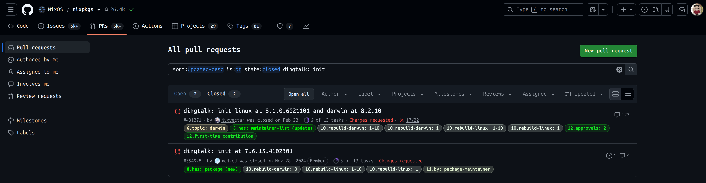

Everyone else queues at the same
window as before, so the bot shortens the line only for those who
already hold the keys. If you're not one yet, there's no shortcut: you
actively reach out to people. I hope the community finds better
solutions down the line.

[^merge-bot]:
    NixOS. _nixpkgs-merge-bot_ - "Allows package maintainers
    to merge in nixpkgs" (repository README). [Online]. Available:
    https://github.com/NixOS/nixpkgs-merge-bot (accessed 2025-08).
    See also _Nixpkgs Contributing Guide_:
    https://github.com/NixOS/nixpkgs/blob/master/CONTRIBUTING.md

Scale isn't the only filter, though. A second one is _regional
asymmetry_: contributors are global, but a reviewer who can't read the
upstream docs, changelogs, or issue tracker can only check that
something builds, not that it behaves. Some **poorly** packaged
versions with strong regional characteristics have therefore landed on
[**main**](https://github.com/NixOS/nixpkgs) relatively quickly,
although things have been improving lately.

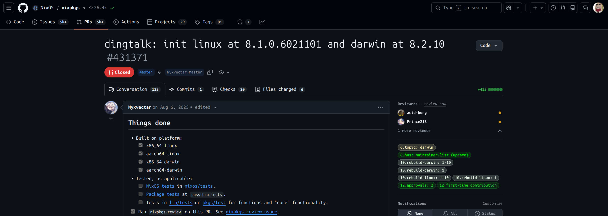

The third filter is the one no one in the pipeline can fix: **the
upstream itself**. For instance, the `dingtalk` package above has
_various problems, large and small_. They all live upstream.
DingTalk ships no changelogs, no versioned tarballs, nothing a packager
can pin. To report to [_**Alibaba**_](https://finance.yahoo.com/quote/BABA/)?
Since they’ve stuffed an LLM into their shopping app, you really shouldn't expect
them to fix your bugs anymore! The outcome was either **silence**, or my personal
favorite, the affected feature being **removed outright**.

> Wow, great job "fixing" the bug by deleting the feature 🫰🏻

```nix collapse={5-15}
meta = {
    description = "Enterprise-level communication platform developed by Alibaba";
    homepage = "https://www.dingtalk.com";
    license = lib.licenses.unfree;
    platforms = [
        "x86_64-linux"
        "aarch64-linux"
        "x86_64-darwin"
        "aarch64-darwin"
    ];
    sourceProvenance = with lib.sourceTypes; [ binaryNativeCode ];
    maintainers = with lib.maintainers; [
        jysve
        prince213
    ];
    mainProgram = "dingtalk";
};
```

The telling line is `sourceProvenance = [ binaryNativeCode ]`: it
declares that the package ships upstream's prebuilt binaries instead of
building from source. It is the honest flag for anything closed-source,
and one more thing a reviewer cannot lean on, because the artifact
they'd be reviewing is upstream's, **not** the community's.

:::note[Regarding My Packaging of DingTalk]
These days it is extremely **difficult** to reach a human customer
service representative at _**Alibaba**_. Opening the support interface
leads to an unhelpful **AI chatbot**. These are problems I cannot
resolve on my own, and many other **closed-source** packages suffer
from the same issue, such as `ToDesk`.
:::

But to tell the truth, none of this makes me pessimistic.
In a time when systems and distros
are thriving everywhere, `Nix` is **a trend** and
`NixOS` is **"the BTW"** now.[^btw]
My own verdict hasn't moved, though. Nix solved problems I didn't
have, and didn't solve one I did, the instability I traced above.
Fedora's boring is exactly what I need right now. I'd still recommend
NixOS to anyone whose pain is environment drift; I just stopped
counting myself in that group.

[^pr]:
    Source: [GitHub search for
    `is:pr`](https://github.com/NixOS/nixpkgs/issues?q=is%3Apr) in the
    NixOS/nixpkgs repository, retrieved August 2025. The count includes
    open and closed PRs since 2012, and closed here includes merged -
    which is rather the point.

[^btw]: For the meme-literate: "I use Arch, btw."

<iframe
  width="100%"
  height="375"
  src="https://www.youtube.com/embed/gvMUNP9n02k?si=I7vBnluDb0L45eBm"
  title="YouTube video player"
  frameborder="0"
  allow="accelerometer; autoplay; clipboard-write; encrypted-media; gyroscope; picture-in-picture; web-share"
  referrerpolicy="strict-origin-when-cross-origin"
  allowfullscreen
></iframe>

## Interludes

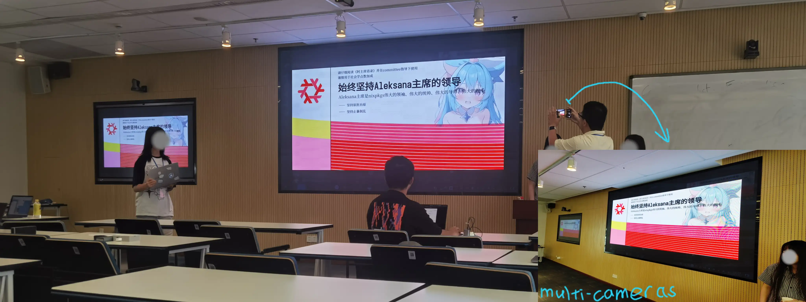

:::tip[Translation]
Unswervingly uphold the leadership of Chairman
[@Aleksana](https://aleksana.moe/).
:::

Yes, that is the actual register of the joke. The over-the-top
formality **is** the point. And underneath the formality:
[@Aleksana](https://aleksana.moe/) is genuinely one of the key figures
in the Nix community, a dedicated contributor, and someone I respect a
great deal.

:::tip[About Aleksana's Website]
If you visit her personal homepage, you'll find that the cards and
tiles in the middle - even the text - are **draggable**. Just a
heads-up: she's usually busy.
:::

She attended remotely. We still came away with a, em, _memento_:

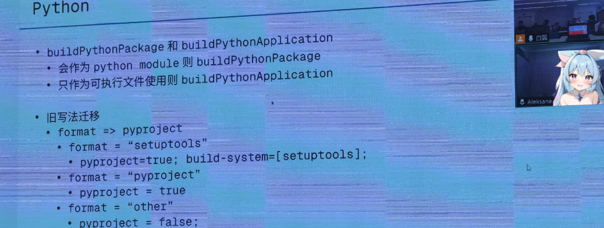


You can leave the Chinese internet, but the Chinese internet never
leaves you.

:::tip[What Does It Mean?]
The figure on the laptop is **Cai Xukun**, a Chinese celebrity whose
basketball performance became one of the most enduring memes of the
Chinese internet; _[Xiao Hei Zi](https://www.reddit.com/r/Chinese/comments/xic71f/what_does_%E5%B0%8F%E9%BB%91%E5%AD%90*mean/)*
is what his ironic fans call themselves. The machine, for those
wondering, is a [_**Lenovo Legion**_](https://www.lenovo.com/us/en/legion/).
:::

:::tip[As We All Know:]
_Some people like to **push their glasses up** with their **middle
finger**. They may be right beside you - sitting quietly, minding their
own business. Get too absorbed in a talk, and you may not gauge the
pressure all that well._
:::

Which is how, deeply absorbed in a talk, I pushed my glasses up with my
middle finger while looking at the speaker on stage - and,
unsurprisingly, :spoiler[_**the glasses broke. From the middle,
btw.**_] Good job. Pop![^5]

[^5]:
    Like the sound you'd hear in a chemistry laboratory,
    attracting everyone's ~~attention~~ stare.

---

## Time to Go Back

I took a few photos before I left. Opportunities like this don't come
easy for me.


Two days only. It felt like torture the whole time. I came here to push
myself, to get over this fear, to talk to people. I failed. Barely a
word out of my mouth the entire time. But even so. It really did
broaden my horizons.

I know I need to step up. Next time.
:spoiler[If there even is a next time] \*sigh.

---

## Chores

### Fedora

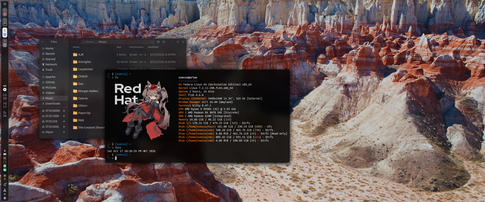

### People Specially

:::hyperlink{href="https://aleksana.moe/" title="Aleksana" avatar="/avatars/Aleksanaa_42209822.webp" description="@aleksanaa. The site with the draggable tiles." logo="/entities/nixos.svg"}
:::

:::hyperlink{href="https://blog.chn.moe/" title="Haonan Chen" avatar="/avatars/CHN_35858462.webp" description="@chn and many. A man not as cute as his avatar." logo="/entities/nixos.svg"}
:::

:::hyperlink{href="https://thiscute.world/en/" title="Ryan Yin" avatar="/avatars/Ryan4yin_22363274.webp" description="@ryan4yin. Long and hard the road, but walkers shall arrive." logo="/entities/nixos.svg"}
:::

:::hyperlink{href="https://prince213.top/" title="Sizhe Zhao" avatar="/avatars/Prince213_25235514.webp" description="@prince213. The vice president of the GeekPie Association." logo="/entities/nixos.svg"}
:::

### Speechless.


